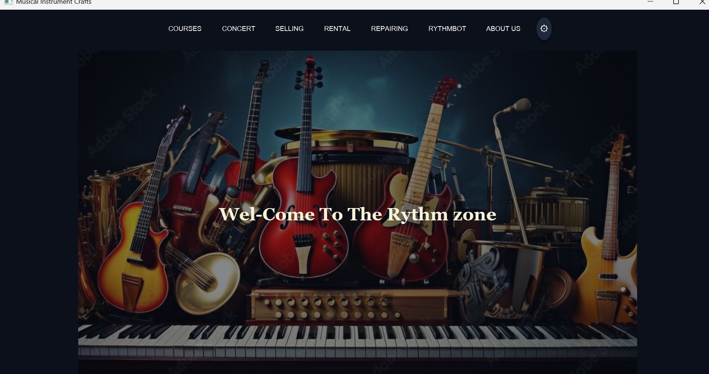
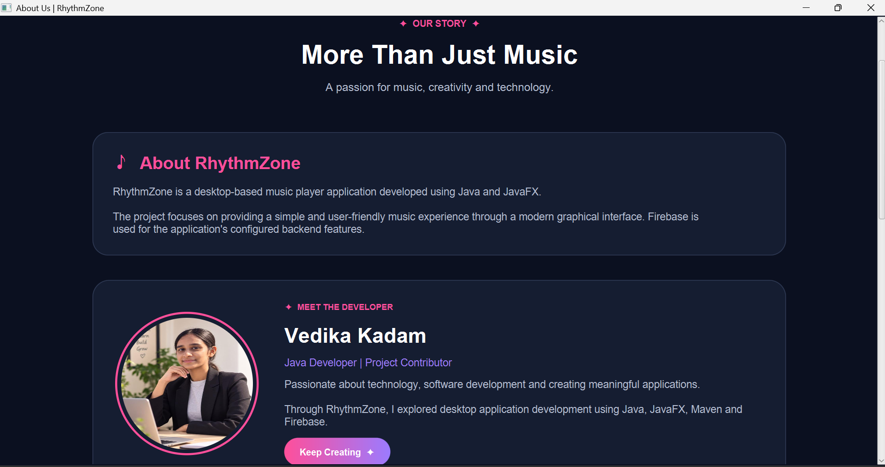
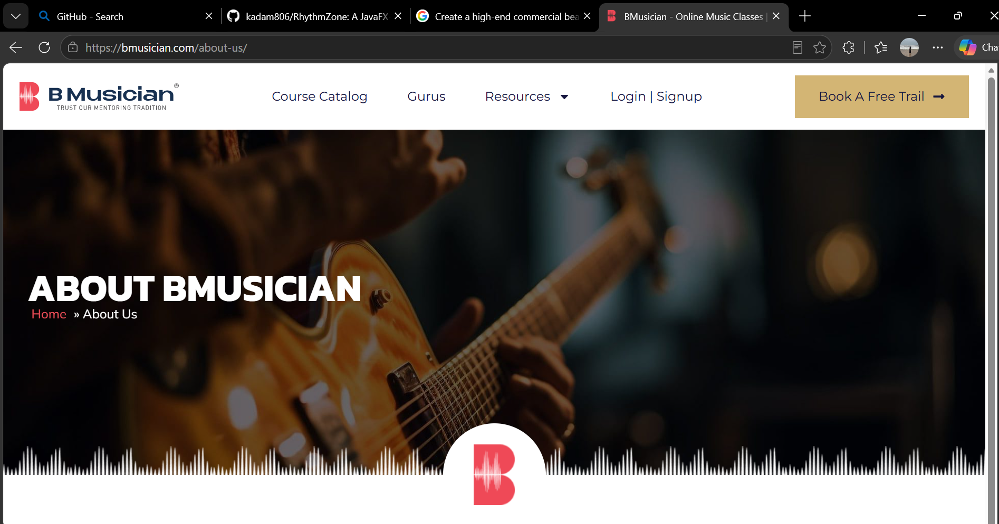
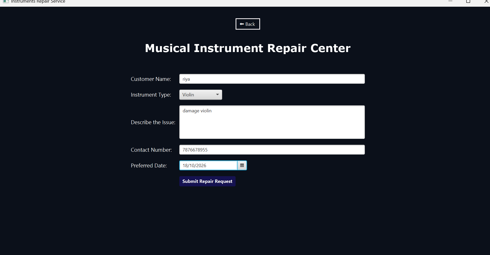
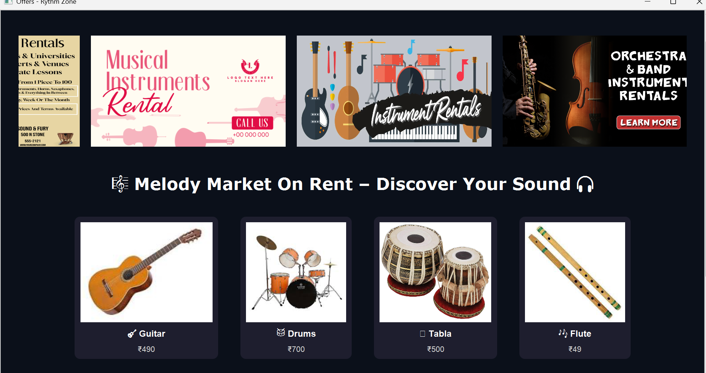

# 🎵 RhythmZone – Music Player Application

## About the Project

RhythmZone is a desktop-based music player application developed using Java and JavaFX.

## Technologies Used

* Java 17
* JavaFX
* Maven
* Firebase

## Features

* User-friendly graphical interface
* User authentication
* Firebase integration
* Music playback functionality

## Prerequisites

* JDK 17
* Apache Maven
* Visual Studio Code

## How to Run

1. Clone the repository:

   bash
   git clone https://github.com/kadam806/RhythmZone.git
   

2. Open the project folder in VS Code.

3. Open the terminal in the folder containing `pom.xml`.

4. Run:

   bash
   mvn javafx:run

## Developer

Vedika Kadam

## GitHub Repository

https://github.com/kadam806/RhythmZone

## 📸 Application Screenshots

### 🏠 Home Page

### ℹ️ About Us Page

### 📚 Courses Page

### 🏠 Repairing Instruments Page

### 🛍️ Rental Instruments Page

